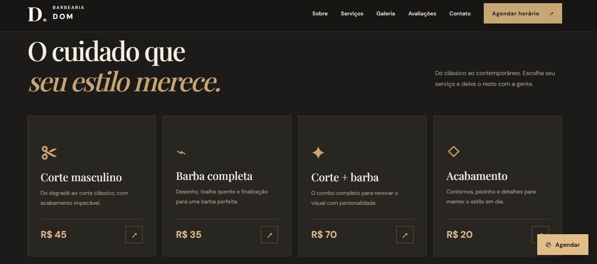
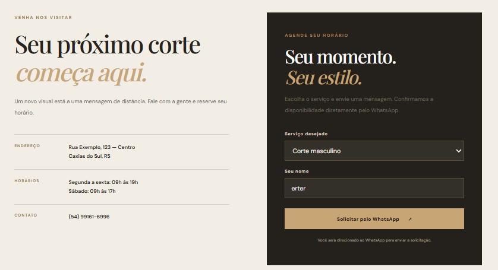

# 💈 Barbearia Dom

Site demonstrativo de uma barbearia, desenvolvido com HTML, CSS e JavaScript.

O projeto apresenta uma interface moderna e elegante, com informações sobre serviços, preços, galeria de imagens e agendamento por WhatsApp.

## 🌐 Projeto online

**Acesse o site publicado:**

https://jefersonalvesrs.github.io/barbearia-dom/

## 🖼️ Pré-visualização

### Página inicial


### Serviços e preços



### Contato e agendamento



### Versão mobile


## ✨ Funcionalidades

- Apresentação da barbearia
- Catálogo de serviços com preços
- Galeria de fotografias
- Depoimentos demonstrativos
- Informações de endereço e horários
- Formulário para solicitar agendamento via WhatsApp
- Mensagem de agendamento preenchida automaticamente
- Menu de navegação adaptado para celulares
- Layout responsivo

## 🛠️ Tecnologias utilizadas

- HTML5
- CSS3
- JavaScript
- Git e GitHub
- GitHub Pages para hospedagem

## 📱 Responsividade

O site possui layout adaptável para computadores, tablets e smartphones, com menu de navegação específico para dispositivos móveis.

## 💡 O que pratiquei neste projeto

- Estruturação de páginas com HTML semântico
- Estilização e layouts com CSS
- Responsividade com Media Queries
- Manipulação do DOM com JavaScript
- Formulários e eventos
- Integração com links de WhatsApp
- Organização de imagens e arquivos
- Versionamento com Git

## 📂 Estrutura do projeto

```text
barbearia/
├── assets/
│   └── images/
│       ├── barbearia-inicio.png
│       ├── barbearia-servicos.png
│       ├── barbearia-agendamento.png
│       └── barbearia-mobile.png
├── imagens/
│   ├── sobre.jpg
│   ├── galeria-1.jpg
│   ├── galeria-2.jpg
│   └── galeria-3.jpg
├── index.html
├── style.css
├── script.js
└── README.md
```

## 📌 Sobre o projeto

A Barbearia Dom é um projeto fictício desenvolvido para fins de estudo, demonstração comercial e portfólio.

Os preços, endereço e depoimentos são ilustrativos. O formulário prepara uma mensagem para o WhatsApp, mas não realiza reservas automaticamente.

O site pode ser personalizado para estabelecimentos reais, com alterações de identidade visual, serviços, preços, imagens e informações de contato.
